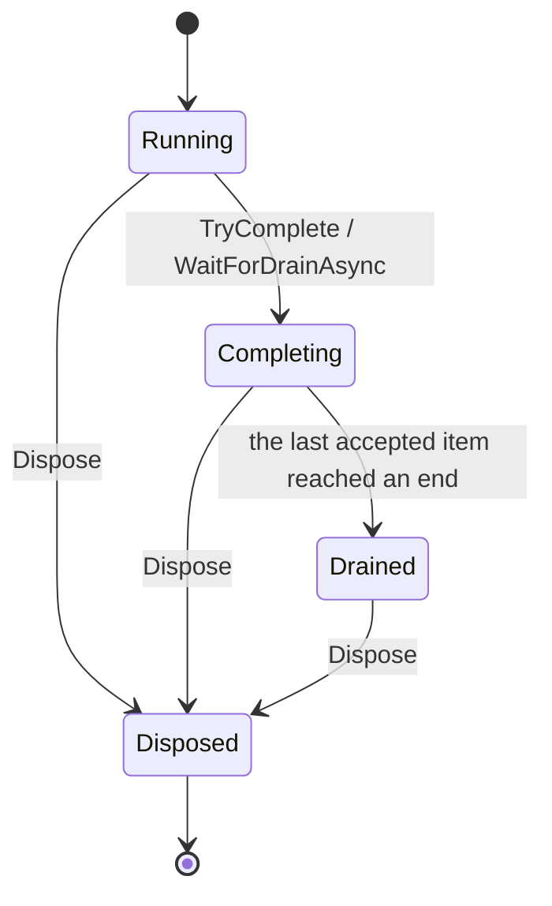
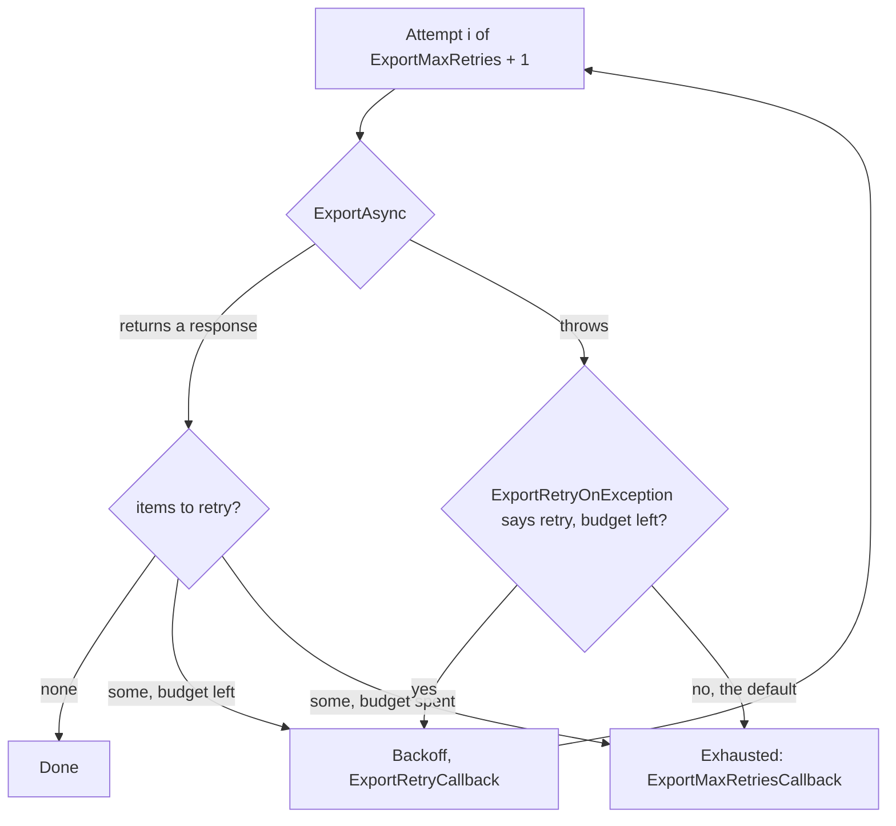
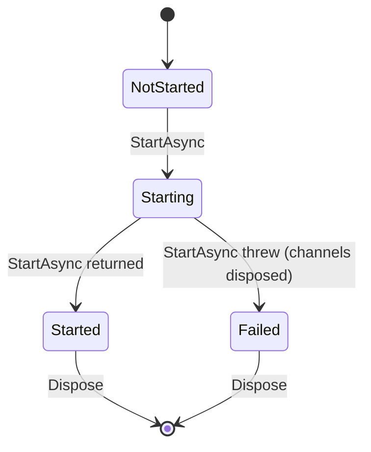

# Channel lifecycle

A buffered channel accepts items until it is completed, finishes the items it accepted, and is then done. These are the states, and what ends an item.

## The channel

- **Running.** `TryWrite` and `WaitToWriteAsync` accept items.
- **Completing.** The inbound channel is closed. The items that were accepted are still moving through the inbound buffer, the outbound channel and the exports.
- **Drained.** Every accepted item reached an end. `WaitForDrainAsync` returns `true`.
- **Disposed.** Terminal. A waiter for the drain is released with `false`, unless the channel had drained.

The transitions are compare-and-swap on one value, so two threads cannot both move the channel on.

## How an item ends

An item is counted when it is accepted, and stops being counted at exactly one of these ends:

| End | What the caller sees |
|---|---|
| Exported | The export returned a response in which the item did not ask to be retried. |
| Exhausted | The retry budget ran out, or the export threw and was not retried. The item is reported through `ExportMaxRetriesCallback`. |
| Dropped by the inbound channel | `BufferItemDropped`, when the full mode drops items. |
| Rejected by the server | `ServerRejectionCallback`. The item was exported, with a status that is not retryable. |

The channel is drained when the count reaches zero after completion. Nothing estimates how many exports are left, and nothing polls.

## One export

An exception that escapes `ExportAsync` is not a response the server gave. The transport retries the failures it models itself and lets an unexpected exception bubble out, so by default the items are given up on and reported, and not sent again with unknown idempotence. Set `BufferOptions.ExportRetryOnException` to say which exceptions are safe to retry for your data.

## The sync orchestrators

`IncrementalSyncOrchestrator` and `DeltaSyncOrchestrator` are started once.

A second `StartAsync` throws. After a failed start there is nothing to write to or complete, and the orchestrator says so. `CompleteAsync` returns `false`, without deleting documents or moving aliases, when a channel did not drain in time.
